# OS/GB — Mac OS 9, Ubuntu y Windows 11 para Game Boy Color

Tres ROMs de Game Boy Color que recrean la experiencia visual de **Mac OS 9**, **Ubuntu** y **Windows 11**. La de Mac OS 9 es la
más completa y recrea, con la mayor fidelidad posible: pantalla de
arranque, escritorio, barra de menús, Launcher, ventanas del Finder y el panel de fondos de pantalla. Todo se maneja con
la cruceta y los botones A/B de la consola, con un cursor de flecha clásico.

<p align="center">
  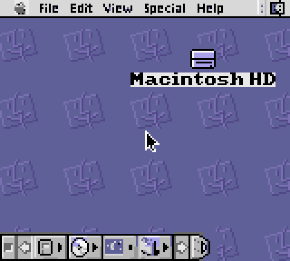
</p>

> **Estado:** primera versión (v0.1) de los tres sistemas. Son una base: muestran y navegan el entorno, pero todavía no
> incluyen aplicaciones. Ver [Alcances](#alcances-de-esta-versión). Las secciones siguientes describen Mac OS 9;
> [Ubuntu GB y Windows 11 GB](#ubuntu-gb-y-windows-11-gb) tiene la suya.

---

## Jugar en el navegador

**▶ [Abrir la web y jugar ahora](https://josue049.github.io/GB-OS/)** — las ROMs corren directamente en tu navegador con un emulador de Game Boy Color
(WasmBoy), sin instalar nada; con el selector eliges Mac OS 9, Ubuntu o Windows 11. Funciona con teclado (flechas, **Z** = A, **X** = B, **Shift** = Select, **Enter** = Start)
y con los botones en pantalla, también en el móvil.

<p align="center">
  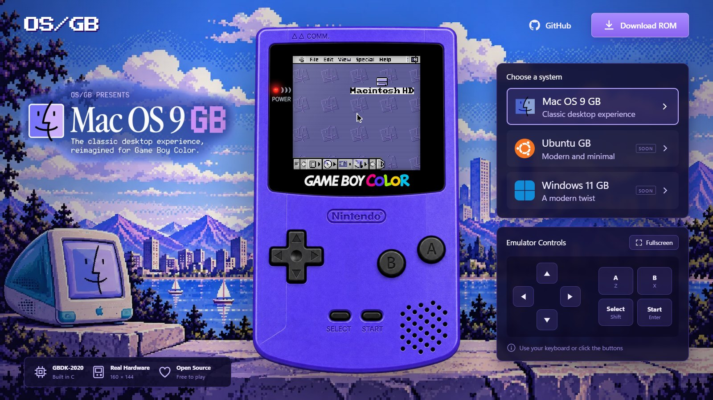
</p>

<table>
  <tr>
    <td align="center">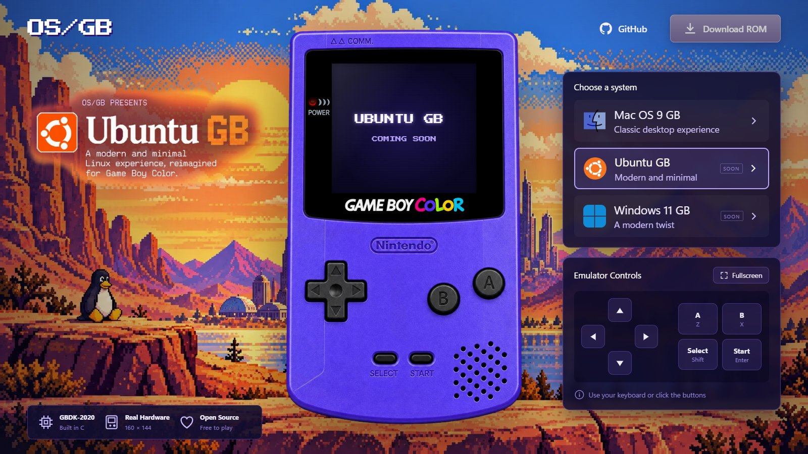<br><sub>Ubuntu GB</sub></td>
    <td align="center">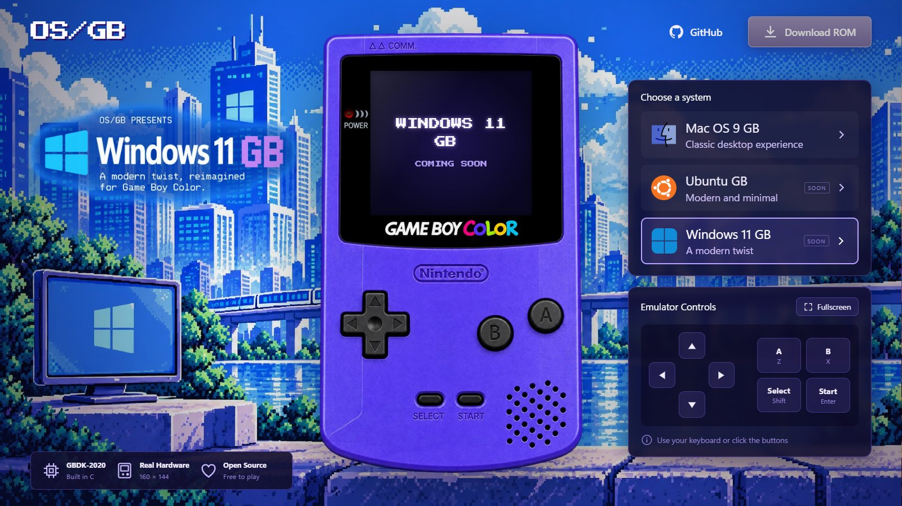<br><sub>Windows 11 GB</sub></td>
  </tr>
</table>

La web es estática (HTML, CSS y JavaScript sin frameworks) y vive en [`web/`](web/). Se publica automáticamente en
GitHub Pages con cada cambio en `main`. Para probarla en local:

```powershell
cd web
python -m http.server 8765      # luego abre http://localhost:8765
```

Para añadir otro sistema basta con agregarlo en [`web/js/systems.js`](web/js/systems.js) y dejar su ROM en `web/roms/`.

---

## Ubuntu GB y Windows 11 GB

<table>
  <tr>
    <td align="center">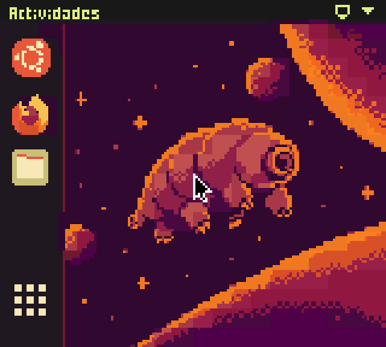<br><sub>Ubuntu GB · escritorio</sub></td>
    <td align="center">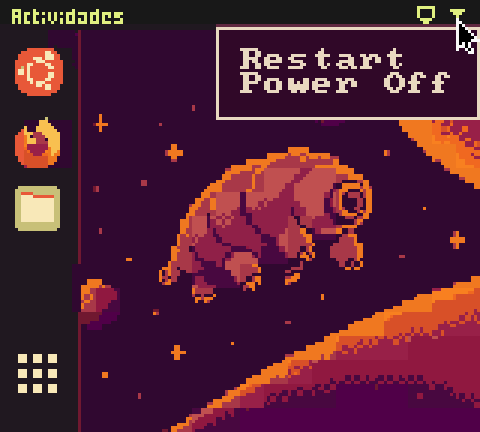<br><sub>Ubuntu GB · menú de la bandeja</sub></td>
  </tr>
  <tr>
    <td align="center">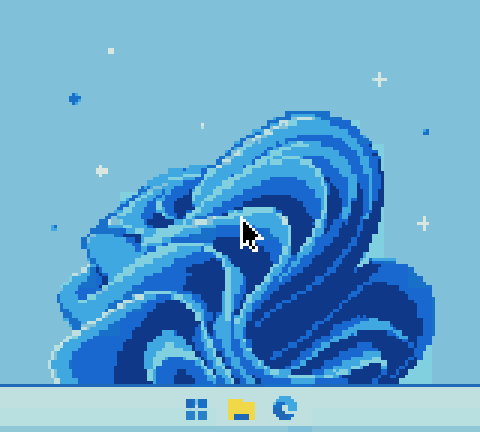<br><sub>Windows 11 GB · escritorio</sub></td>
    <td align="center">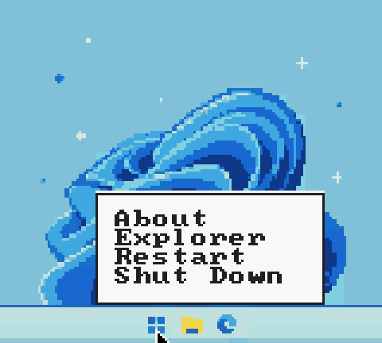<br><sub>Windows 11 GB · menú Inicio</sub></td>
  </tr>
</table>

Dos ROMs más: [`build/UbuntuGB.gbc`](build/UbuntuGB.gbc) y [`build/Windows11GB.gbc`](build/Windows11GB.gbc). Su escritorio sale
directamente de las imágenes de [`reference/`](reference/) (160×144): `tools/convert_sistema.py` calcula las paletas de
Game Boy Color agrupando (k-means) los colores de cada tile, genera el arranque con barra de progreso y reutiliza la fuente,
las piezas de ventana/menú y el cursor del Mac OS 9. El código común está en [`src/sistema/sistema.c`](src/sistema/sistema.c)
y se compila con `-DSIS_UBUNTU` o `-DSIS_WINDOWS`.

| Sistema | Qué se puede hacer (A pulsa, B cierra) |
|---------|----------------------------------------|
| **Ubuntu GB** | *Actividades* y el dock (Ubuntu, Firefox, Archivos, Aplicaciones) abren ventanas; la bandeja superior derecha abre un menú con *Restart* y *Power Off*. |
| **Windows 11 GB** | El botón Inicio abre un menú (*About*, *Explorer*, *Restart*, *Shut Down*); en la barra de tareas, el Explorador y Edge abren su ventana. |

Ambos tienen arranque con fundidos, cursor con cruceta, ventanas con animación de zoom y un solo fondo (sin panel de ajustes
ni guardado en SRAM). Los títulos de ventana solo admiten letras, por la fuente de títulos heredada del Mac OS 9.

## Motivo del proyecto

Mac OS 9 tiene una identidad gráfica muy reconocible (la interfaz *Platinum*, el Launcher, la cara del Finder) y la
Game Boy Color tiene límites muy concretos: pantalla de **160×144**, tiles de 8×8 y **paletas de 4 colores**. El reto de
OS/GB es ver hasta dónde se puede llevar un escritorio de los 2000 a esa consola sin renunciar a su estética.

El diseño parte de un archivo de GIMP (`assets/source/MacOS9.xcf`) y de una paleta propia para Game Boy Color
(`assets/source/MacOS9_GBC_fondos.gpl`). El código convierte esas imágenes en tiles y mapas reales para la consola, de modo
que lo que se ve en pantalla es el diseño original adaptado, no una reinterpretación.

## Capturas

<table>
  <tr>
    <td align="center">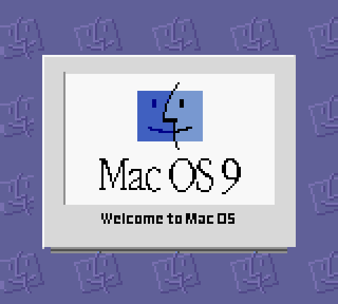<br><sub>Bienvenida</sub></td>
    <td align="center">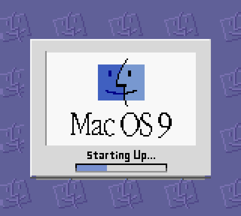<br><sub>Starting Up… con barra de progreso</sub></td>
  </tr>
  <tr>
    <td align="center">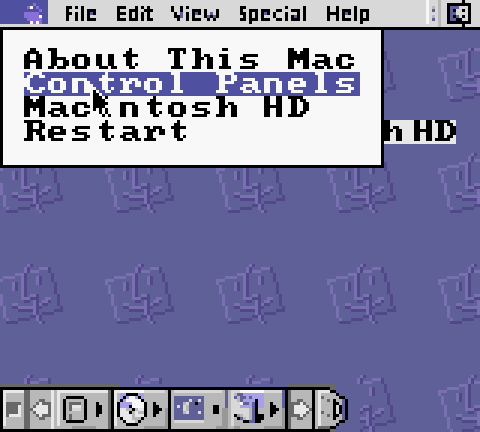<br><sub>Menú Apple</sub></td>
    <td align="center">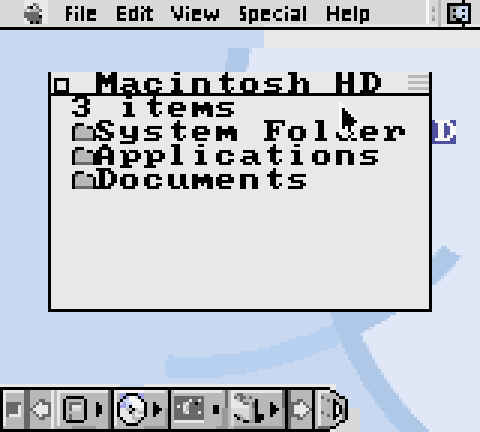<br><sub>Ventana de Macintosh HD</sub></td>
  </tr>
  <tr>
    <td align="center">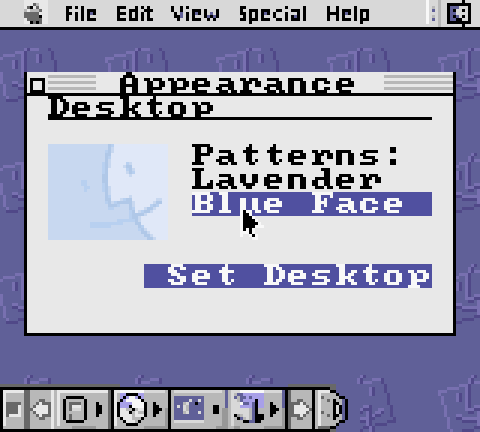<br><sub>Control Panels › Appearance › Desktop</sub></td>
    <td align="center">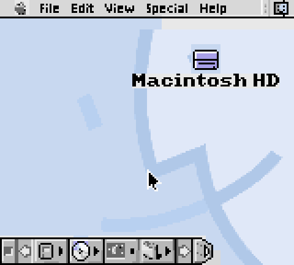<br><sub>Segundo fondo de escritorio (Blue Face)</sub></td>
  </tr>
</table>

## Funcionamiento

### Controles

| Botón | Acción |
|-------|--------|
| **Cruceta** | Mueve el cursor (acelera si la mantienes pulsada) |
| **A** | Selecciona / pulsa lo que hay bajo el cursor |
| **B** | Retrocede: cierra el menú, luego la ventana y por último la selección |

### Flujo del sistema

1. **Arranque.** Fundido a la pantalla *Welcome to Mac OS*; al instante cambia a *Starting Up…* con una barra de progreso
   animada, y entra al escritorio con un fundido.
2. **Escritorio.** Barra de menús y Launcher del diseño original, e icono **Macintosh HD**. Un clic con A lo selecciona
   y un segundo clic lo abre.
3. **Menú Apple.** *About This Mac*, *Control Panels*, *Macintosh HD* y *Restart*. El menú **Special** ofrece *Restart*
   y *Shut Down*.
4. **Ventanas.** Barra de título con botón de cierre, animación de zoom al abrir y cerrar, y contenido básico
   (Finder, About y panel de fondos).
5. **Launcher.** El primer botón abre Macintosh HD y el del monitor abre *About*; los demás reaccionan al pulsarlos.
6. **Fondos de pantalla.** En *Control Panels › Appearance › Desktop* eliges entre **Lavender** (el patrón morado) y
   **Blue Face**, con miniatura de vista previa y botón *Set Desktop*. El cambio es inmediato y **se guarda en la SRAM del
   cartucho**, así que se conserva al reiniciar o apagar.

## Alcances de esta versión

**Incluye**

- Pantalla de arranque en dos fases con fundidos.
- Escritorio fiel al diseño, cursor controlado con la cruceta y selección con A/B.
- Menús Apple y Special, ventanas del Finder / About / Control Panels y Launcher con acciones.
- Dos fondos de escritorio seleccionables y persistentes.
- Conversión automática de los gráficos originales a tiles de Game Boy Color.

**No incluye todavía**

- Aplicaciones (calculadora, editor de texto, etc.), archivos reales ni sistema de carpetas.
- Los menús File, Edit, View y Help (son solo imagen), ni arrastrar ventanas o iconos.
- Sonido.
- Las pestañas Themes, Fonts, Sound y Options del panel Appearance.

**Limitaciones de hardware que se resolvieron así**

- Cada tile de 8×8 solo puede usar 4 colores: el conversor elige para cada tile la paleta de las 8 disponibles que
  menos error produce y reutiliza tiles repetidos (también reflejados).
- La consola admite 256 tiles por banco de VRAM: el arranque y cada escritorio se reparten el banco 0 (se recarga al
  cambiar de pantalla o de fondo), mientras que la fuente y las piezas de interfaz viven fijas en el banco 1.
- Las ventanas, menús y texto usan una fuente de 8×8 y piezas de interfaz fijas, no imágenes por ventana.

## Cómo ejecutarla

Las ROMs ya compiladas están en [`build/`](build/): `MacOS9.gbc`, `UbuntuGB.gbc` y `Windows11GB.gbc`.

- **Emulador:** cualquiera compatible con Game Boy Color: [BGB](https://bgb.bircd.org/), [SameBoy](https://sameboy.github.io/),
  [mGBA](https://mgba.io/) o [Gambatte](https://github.com/sinamas/gambatte). Abre el archivo `.gbc`.
  En BGB los botones A y B son por defecto las teclas **S** y **A**.
- **Consola real:** la ROM es *solo para Game Boy Color* (no arranca en una Game Boy clásica) y necesita un cartucho
  flash (por ejemplo EverDrive) que permita guardar en SRAM. No se ha probado en hardware real.

## Compilar desde el código

Requisitos (Windows):

- [GBDK-2020](https://github.com/gbdk-2020/gbdk-2020/releases) (compilador `lcc`).
- Python 3 con [Pillow](https://pypi.org/project/pillow/) y [NumPy](https://numpy.org/) (`pip install pillow numpy`).

```powershell
$env:GBDK_HOME = "C:\ruta\a\gbdk"          # carpeta de GBDK-2020 (o deja lcc en el PATH)
powershell -ExecutionPolicy Bypass -File build.ps1                    # los tres sistemas
powershell -ExecutionPolicy Bypass -File build.ps1 -Sistema ubuntu    # o macos9 | windows11
```

Esto regenera los gráficos (`assets/generated/`) y compila las ROMs en `build/`.

Para volver a exportar las capas desde el diseño de GIMP (necesita GIMP 2.10), desde la raíz del proyecto:

```
gimp-console-2.10 -i -b "(python-fu-eval 1 \"execfile('tools/export_layers.py')\")" -b "(gimp-quit 0)"
```

## Estructura del proyecto

```
src/               Código C del sistema
  main.c           Punto de entrada: arranque y escritorio en bucle
  boot.c           Pantallas de bienvenida y carga
  desktop.c        Bucle del escritorio, icono, launcher y cambio de fondo
  menu.c           Menús desplegables Apple y Special
  window.c         Ventanas (Finder, About, Appearance > Desktop)
  cursor.c         Sprite del cursor
  config.c         Ajustes guardados en SRAM
  ui.c, os.h       Utilidades de pantalla, texto, paletas y fundidos (también las usan Ubuntu y Windows)
  sistema/         sistema.c: arranque, escritorio, menú y ventanas de Ubuntu GB y Windows 11 GB
assets/source/     Diseño original: XCF de GIMP, paleta .gpl, capas exportadas y capturas del arranque
assets/generated/  Tiles, mapas y paletas convertidos (gen_graficos.c/.h)
tools/             convert_assets.py (Mac OS 9), convert_sistema.py (Ubuntu y Windows), export_layers.py (GIMP) y fuente 8x8
reference/         Imágenes de escritorio de Ubuntu y Windows 11 (160×144) de las que se generan sus ROMs
build/             ROMs compiladas
web/               Web estática con el emulador (se publica en GitHub Pages)
docs/img/          Capturas usadas en este README
.github/workflows Despliegue de la web en GitHub Pages
```

## Datos técnicos

- Mac OS 9: cartucho MBC1 + RAM con batería, 32 KB de ROM, 8 KB de SRAM (se usan 4 bytes, validados con firma y checksum). Ubuntu y Windows 11: MBC1 sin RAM, 32 KB.
- Fondo: 8 paletas de 4 colores por pantalla; sprites: 1 paleta (cursor 8×12 px en un sprite 8×16).
- Colores definidos en RGB15 (5 bits por canal) redondeando desde los valores de la paleta original.
- Fuente de texto 8×8 basada en la tipografía pública *font8x8* (dominio público).

## Próximos pasos

- Pantalla de inicio definitiva y más fondos de escritorio.
- Panel de ajustes y fondos para Ubuntu y Windows 11.
- Aplicaciones básicas y un sistema de ventanas con arrastre.
- Menús File, Edit, View y Help funcionales.

## Créditos y aviso

- Autor: [Josue049](https://github.com/Josue049) — diseño, programación y desarrollo del proyecto.
- Compilado con [GBDK-2020](https://github.com/gbdk-2020/gbdk-2020).
- Emulador web: [WasmBoy](https://github.com/torch2424/wasmboy).
- Fuente 8×8: [font8x8](https://github.com/dhepper/font8x8) (dominio público).

Este es un proyecto fan sin ánimo de lucro y **sin relación con Apple Inc., Canonical Ltd. ni Microsoft Corporation**. *Macintosh*,
*Mac OS* y *Finder* son marcas registradas de Apple Inc.; *Ubuntu* lo es de Canonical Ltd.; *Windows* y *Edge*, de Microsoft Corporation.
